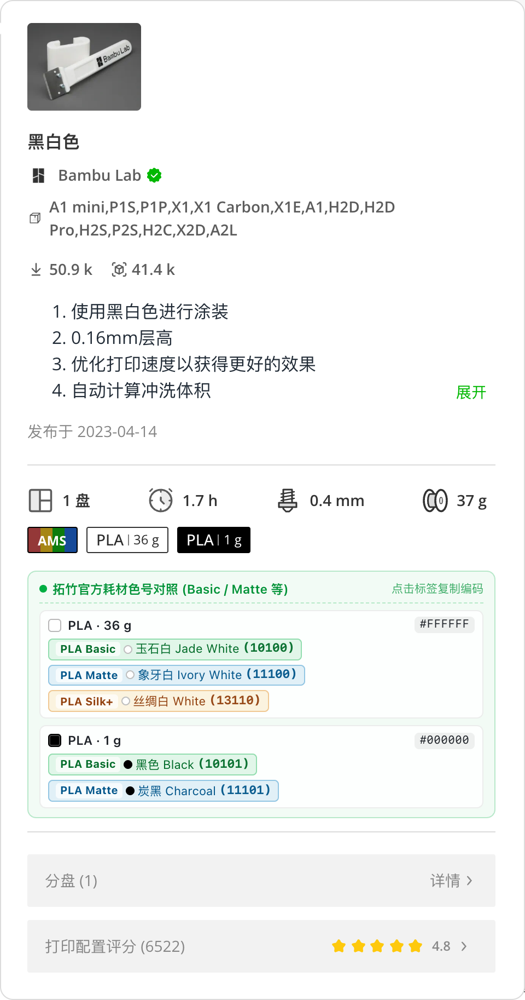

# MakerWorld 拓竹耗材色号与编码助手 | Bambu Lab Filament Color & Code Matcher

[中文说明](#-中文说明) | [English](#-english-documentation)

<p align="center">
  
</p>

---

## 🇨🇳 中文说明

### 项目简介

在浏览 [MakerWorld](https://makerworld.com.cn/) / [MakerWorld Global](https://makerworld.com/) 模型页面时，原有的打印配置耗材明细仅显示材质（如 `PLA`）与颜色方块，不显示对应的**拓竹官方耗材颜色名称**与 **5 位官方耗材编码（SKU Code）**。

本浏览器插件可自动解析页面打印配置卡片、悬停详情浮层（Popover）及分盘详情中的耗材色块，**同时关联显示拓竹官方各主力系列（如 `PLA Basic`、`PLA Matte`、`PLA Silk+`、`PETG HF`、`PETG Basic`、`PETG Matte`、`ABS`、`ASA`、`TPU` 等）的中英文颜色名称、5 位耗材编码与官方 Hex 色值**。

### 核心特性

- **多系列同时对照展示（Basic / Matte / Silk+ / HF 等）**
  - 例如当打印配置中包含白色 `PLA`（`#FFFFFF`）时，自动并列展示：
    - `PLA Basic` · **玉石白 Jade White (`10100`)**
    - `PLA Matte` · **象牙白 Ivory White (`11100`)**
    - `PLA Silk+` · **丝绸白 White (`13110`)**
  - 当包含黑色 `PLA`（`#000000`）时，自动并列展示：
    - `PLA Basic` · **黑色 Black (`10101`)**
    - `PLA Matte` · **炭黑 Charcoal (`11101`)**
- **官方精确匹配 + CIELAB ($\Delta E$) 感知色差近似匹配**
  - 内置 230+ 款拓竹官方耗材色卡数据库。
  - 若模型作者使用了自定义 RGB 颜色，插件会通过 CIELAB ($\Delta E$) 色差算法自动计算并推荐同材质下最接近的 `Basic` / `Matte` 官方色号，并标注 `≈` 与色差值。
- **一键快捷复制**
  - **点击色号标签**：直接复制 5 位耗材编码（如 `10100`）。
  - **按住 `Shift` + 点击标签**：复制完整耗材名称与编码（如 `Bambu PLA Basic 玉石白 (10100)`）。
  - **点击右侧 `#Hex` 色值**：复制十六进制颜色代码（如 `#FFFFFF`）。
- **内置全量色卡速查弹窗 (`popup.html`)**
  - 点击浏览器右上角扩展图标，即可按中文名、英文名、5 位耗材编码（如 `10100`、`11201`）、系列或 `#Hex` 实时检索全套拓竹官方耗材。
- **全平台兼容**
  - 支持 **Chrome / Edge / Brave / Arc**（Manifest V3 扩展）
  - 支持 **macOS Safari**（内置完整 Xcode Safari Web Extension 工程）
  - 支持 **Tampermonkey / Violentmonkey / Userscripts / Stay**（提供单文件油猴脚本）

---

### 安装说明

#### 方式一：Chrome / Edge / Arc / Brave 浏览器扩展（推荐）

1. 克隆或下载本仓库到本地：
   ```bash
   git clone https://github.com/JingenChen/makerworld-bambu-filament-helper.git
   ```
2. 打开浏览器扩展管理页面：
   - Chrome：`chrome://extensions/`
   - Edge：`edge://extensions/`
3. 开启右上角的 **「开发者模式 (Developer mode)」**。
4. 点击左上角 **「加载已解压的扩展程序 (Load unpacked)」**，选择本仓库根目录即可立即生效。

#### 方式二：Tampermonkey / Violentmonkey / Safari Userscripts 油猴脚本

1. 在浏览器中安装 **Tampermonkey**（Chrome/Edge/Firefox）或 **Userscripts / Stay**（Safari）。
2. 打开本仓库中的 [`makerworld-bambu-filament.user.js`](./makerworld-bambu-filament.user.js) 文件（或点击 GitHub 页面上的 `Raw` 按钮）。
3. 将脚本添加至管理器并保存，访问 `makerworld.com.cn` 或 `makerworld.com` 即可自动生效。

#### 方式三：macOS Safari 原生扩展（Xcode 编译）

本仓库在 [`safari-extension/BambuFilamentHelper/`](./safari-extension/BambuFilamentHelper/) 目录下提供了完整的 Xcode 工程：

1. 使用命令行一键编译本地应用：
   ```bash
   xcodebuild -project "safari-extension/BambuFilamentHelper/BambuFilamentHelper.xcodeproj" \
     -scheme "BambuFilamentHelper" \
     -configuration Debug \
     -derivedDataPath "/tmp/BambuSafariBuild" \
     CODE_SIGN_IDENTITY="-" \
     AD_HOC_CODE_SIGNING_ALLOWED=YES \
     build
   cp -R "/tmp/BambuSafariBuild/Build/Products/Debug/BambuFilamentHelper.app" /Applications/
   open -g /Applications/BambuFilamentHelper.app
   ```
2. 打开 **Safari 浏览器 -> 设置 (`⌘ + ,`)**：
   - 在 **「高级 (Advanced)」** 中勾选 **「显示网页开发者功能」**。
   - 在 **「开发者 (Developer)」** 中勾选 **「允许未签名的扩展 (Allow Unsigned Extensions)」**（若在 Xcode 中配置了个人 Apple ID 签名证书则无需此步）。
   - 在 **「扩展 (Extensions)」** 中勾选启用 **「MakerWorld 拓竹耗材色号与编码助手」** 并允许访问网站。

---

### 项目目录结构

```text
├── manifest.json                      # Chrome / Edge Manifest V3 扩展配置
├── filaments-db.js                    # 拓竹官方全系耗材色卡库 (230+ 条目) 与 CIELAB 匹配引擎
├── content.js                         # MakerWorld 页面 DOM 监听与色号对照卡片注入脚本
├── styles.css                         # 自适应亮色/暗色模式的插件样式表
├── popup.html                         # 浏览器右上角拓竹耗材色卡速查弹窗页面
├── popup.js                           # 速查弹窗搜索与过滤交互逻辑
├── icons/                             # 插件图标 (16 / 32 / 48 / 128 px)
├── makerworld-bambu-filament.user.js  # 单文件油猴脚本版 (Tampermonkey / Userscripts)
├── safari-extension/                  # macOS Safari Web Extension Xcode 工程源码
└── preview-popover.png                # 插件实际渲染效果预览图
```

---

## 🌐 English Documentation

### Overview

When browsing 3D model pages on [MakerWorld](https://makerworld.com/) or [MakerWorld CN](https://makerworld.com.cn/), the filament list in print profiles only shows the material type (e.g., `PLA`) and a color swatch without displaying the corresponding **Bambu Lab official color name** or **5-digit filament SKU code**.

**MakerWorld Bambu Filament Matcher** automatically detects filament blocks in print profile popovers and plate detail views, and **simultaneously displays matching official Bambu Lab filaments across series (`PLA Basic`, `PLA Matte`, `PLA Silk+`, `PETG HF`, `PETG Basic`, `PETG Matte`, `ABS`, `ASA`, `TPU`, etc.) along with their bilingual names, 5-digit filament codes, and official Hex values**.

### Key Features

- **Multi-Series Side-by-Side Comparison (`Basic` / `Matte` / `Silk+` / `HF`)**
  - For example, a white `PLA` (`#FFFFFF`) slot automatically displays:
    - `PLA Basic` · **玉石白 Jade White (`10100`)**
    - `PLA Matte` · **象牙白 Ivory White (`11100`)**
    - `PLA Silk+` · **丝绸白 White (`13110`)**
  - A black `PLA` (`#000000`) slot automatically displays:
    - `PLA Basic` · **黑色 Black (`10101`)**
    - `PLA Matte` · **炭黑 Charcoal (`11101`)**
- **Exact Match + Perceptual Color Difference (CIELAB $\Delta E$) Matching**
  - Built-in database of 230+ official Bambu Lab filaments.
  - When a designer uses a custom RGB color, the extension calculates perceptual color distance ($\Delta E$) in CIELAB space to recommend the closest official `Basic` and `Matte` colors (marked with `≈`).
- **One-Click Copy**
  - **Click any badge**: Copies the 5-digit filament code (e.g., `10100`).
  - **`Shift` + Click any badge**: Copies the full filament name and code (e.g., `Bambu PLA Basic 玉石白 (10100)`).
  - **Click the `#Hex` tag**: Copies the hexadecimal color string.
- **Built-in Filament Swatch Search Popup (`popup.html`)**
  - Click the extension icon in the browser toolbar to search all official Bambu Lab filaments by color name, 5-digit code, series, or `#Hex`.

---

### Installation

#### Option 1: Chrome / Edge / Brave / Arc (Unpacked Extension)

1. Clone or download this repository:
   ```bash
   git clone https://github.com/JingenChen/makerworld-bambu-filament-helper.git
   ```
2. Open `chrome://extensions/` (or `edge://extensions/`).
3. Enable **Developer mode** in the top-right corner.
4. Click **Load unpacked** and select the root folder of this repository.

#### Option 2: Userscript (Tampermonkey / Violentmonkey / Safari Userscripts)

1. Install a userscript manager such as **Tampermonkey** or **Userscripts** (for Safari).
2. Import [`makerworld-bambu-filament.user.js`](./makerworld-bambu-filament.user.js).
3. Visit `makerworld.com` or `makerworld.com.cn` and hover over any print profile to see the filament matcher panel.

#### Option 3: Native macOS Safari Web Extension

1. Open [`safari-extension/BambuFilamentHelper/BambuFilamentHelper.xcodeproj`](./safari-extension/BambuFilamentHelper/BambuFilamentHelper.xcodeproj) in Xcode, or build via CLI using `xcodebuild`.
2. In **Safari -> Settings -> Developer**, check **Allow Unsigned Extensions** (if built without an Apple Developer signing team).
3. Enable **BambuFilamentHelper** under **Safari -> Settings -> Extensions** and grant permission for `makerworld.com` and `makerworld.com.cn`.

---

## License

Released under the [MIT License](./LICENSE).
